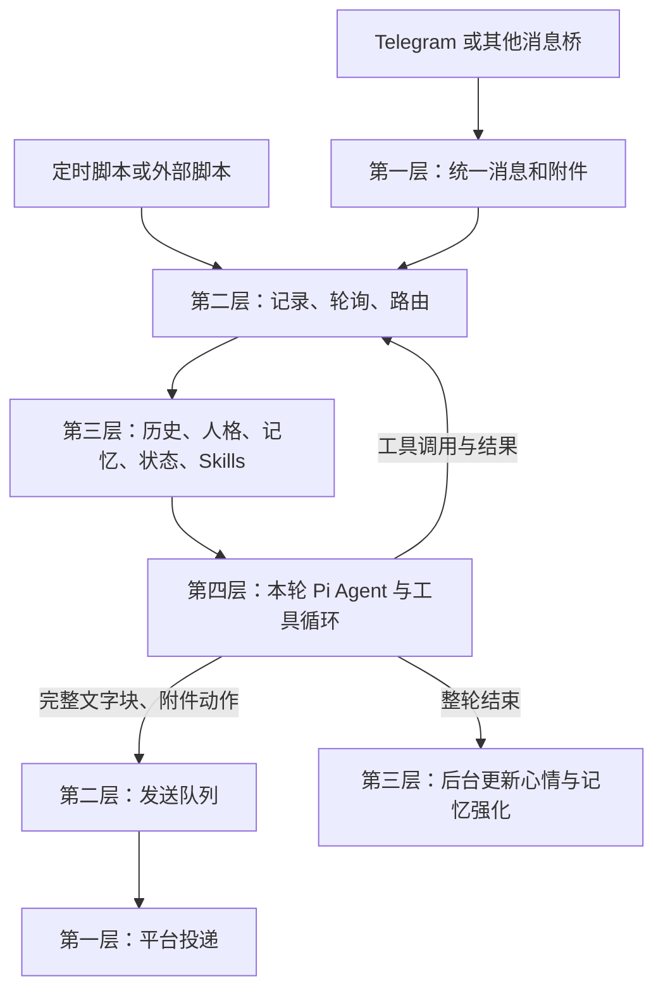

# Hineni 完整手册

本文是整个项目的阅读入口，面向使用者和接手项目的 AI。按 2026-11-02 的实际代码整理；描述的是程序已经怎样工作，不把设计设想当成已实现功能。默认值与当前安装值可能不同，当前值由根目录默认配置与 `agents/<id>/config.yaml` 的个人设置共同决定，个人字段优先。

新版管理工作台操作见 [工作台使用与调试](console.md)：Telegram 接入单独填写 Chat ID；工作台区分原始记录、当前压缩视图和实际交接；各参数和文件旁都有作用、存储位置与生效说明。

配置项旁现在提供从读取、计算到写回的完整流程；文件解释见 [文件如何参与运行](files-guide.md)。保存按钮含义在操作栏的问号内。

配置与文件归属见 [每个 Agent 的配置与定时任务](agent-layout.md)。主目录是公共设施和公共默认值，个人配置、模型 Key、提示词与定时脚本各归自己。

## 目录与阅读顺序

| 你现在想做什么                       | 阅读位置                                                                   |
| ------------------------------------ | -------------------------------------------------------------------------- |
| 知道做了什么、怎么用、文件在哪       | 本文                                                                       |
| 修改模型、人格、记忆、主动行为、工具 | [配置指南](configuration-guide.md)；有操作步骤和可合并的配置片段           |
| 查一个参数的默认值与含义             | [逐项配置说明](configuration-reference.md)；含文件、字段路径、生效方式     |
| 理解每条流程、计算方法、失败与重启   | [内部流程](internals.md)                                                   |
| 接第三方入口、脚本或替换执行器       | [协议](protocol.md)、[内部流程的代码地图](internals.md#代码地图与修改规则) |
| 启动、备份、迁移 VPS                 | [运行与迁移](operations.md)                                                |
| 判断哪些能力真正测过                 | [验证记录](validation.md)                                                  |
| 回看以前讨论的需求                   | [原设计文档](design-reference.md)，它不是当前实现保证                      |

AI 接手时先读 [AGENTS.md](../AGENTS.md)，按功能定位本文或其他文档的相关章节；无需通读手册或把全部设计讨论放进上下文。配置格式以 `src/config/schema.ts` 为准，四层协议以 `src/contracts/index.ts` 为准，执行行为以本文链接的代码为准。发现文档与代码不符时，要明确指出并同步修正文档。

## 1. 现在这个程序是什么

Hineni 是一个运行在电脑或 VPS 上的个人 agent 后端。聊天软件作为入口，我们自己的程序保存经历、选择上下文和管理记忆，再交给 Pi 执行模型和工具循环。

当前安装只有一个 agent，编号 `main`，显示名 Hineni，Telegram 私聊已接通。普通回复回到触发来源，内部提醒没有指定来源时使用默认 Telegram 私聊。网页的本地测试入口也共享同一条经历，但回复放在本地收件箱。

当前主进程是一个 Node.js 程序，内部有四个组件；调度脚本是子进程，MCP stdio 服务也可以是子进程。不是四套独立服务。程序目前在这台 Mac 上运行，尚未配置开机自启，也没有部署到 VPS。

第二层收到工具记录、agent 回复和发送确认只保存，不再触发推理。收到用户消息、内部事件、附件就绪或失败，才触发新一轮。

## 2. 模型各自做什么

| 配置位置                                  | 当前默认模型             | 负责的工作                                                    |
| ----------------------------------------- | ------------------------ | ------------------------------------------------------------- |
| `models.main`                             | `gpt-4.1`                | 对话、工具决策、通过 Skill 整理记忆、旧历史压缩、网页搜索请求 |
| `models.fast`                             | `gpt-4.1-mini`           | 查询扩展、记忆检索句生成、召回重排、回合后心情判断            |
| `models.embedding`                        | `text-embedding-3-small` | 把记忆和查询转换成向量，供本地相似度计算                      |
| `models.query/maintenance/emotion/rerank` | 默认继承 fast            | 可为四类辅助工作分别指定模型                                  |

第一层不使用模型；第二层只有压缩时调用模型；第三层是程序算法加辅助 API；第四层是 Pi 驱动主模型。Pi 本身不是模型，也没有保存我们每轮之间的长期 session。

当前三个模型使用 OpenAI 官方地址和 `agents/main/.env` 里的 `OPENAI_API_KEY`。主回复每次输出最多 8192 token，快模型最多 2000 token。这些是配置选择，不是“已经选到最新或最适合你的模型”的结论。

一次聊天可能发生：查询模型 → 查询向量 → 重排 → 主模型一次或多次 → 后台心情模型。没有记忆时跳过自动召回；达到历史阈值才压缩。定时整理、索引维护、主动闲聊也会调用 API。

## 3. 你平时怎样使用

在 Telegram 中正常聊天即可。可以直接说“帮我创建文件”“查一下之前提过的事”“记住这件事”。是否写长期记忆由主模型结合 personal-memory Skill 决定；每条普通聊天不会自动逐条变成长记忆。

文件需要让它调用 `send_attachment` 发送；只在文字里提到本地路径不会发送文件。可以只点表情，也可以用 `finish_without_reply` 保持沉默。

新消息会打断当前工作。已经完成的外部操作不会撤销；已经进发送队列的文字继续发送。下一轮能看到此前已记录的操作，模型自行判断接下来做什么。停止按钮也只停止当前执行，不清空历史和发送队列。

管理页是 `http://127.0.0.1:8788`。顶部填写 `.env` 的 `HINENI_TOKEN`，这是管理口令；OpenAI key 和 Telegram token 不填在这里。

| 页面                       | 实际用途                                                     |
| -------------------------- | ------------------------------------------------------------ |
| 工作台                     | 当前 agent 聊天、附件、事件与工具时间线                      |
| 执行与工具                 | 每轮工具输入输出、完整结果文件、终端输出、投递状态           |
| 上下文                     | 初始编排及每次主模型请求前快照，支持分页和下载               |
| 配置 / 模型与密钥 / Agents | 参数表单、模型获取与切换、凭据、独立 agent；暂存、保存并重启 |
| 文件与文档 / Skills        | 编辑真实文件和文档，安装/编辑/归档移除技能                   |
| 程序日志                   | 程序诊断、模型错误、召回与调度信息                           |

工具明细和诊断日志分开展示。密钥通过专用界面更新且不回显；state 和原始运行记录只读。功能、保存语义与界限详见[工作台使用与调试](console.md)。状态中的 configured=true 仍只表示凭据存在。

## 4. 常见配置应该去哪改

| 你想改变什么                  | 修改位置                                                | 何时生效                                     |
| ----------------------------- | ------------------------------------------------------- | -------------------------------------------- |
| 主模型、辅助模型、上下文大小  | `config.yaml` 的 models/history/context                 | 重启主程序                                   |
| 模型 key、Bot Token、管理口令 | `.env`                                                  | 重启主程序                                   |
| 它是谁、态度与习惯            | `agents/main/persona.md`                                | 下一轮                                       |
| 全局行为原则                  | `prompts/system.md`，若配置了 prompts.system 则由它覆盖 | 下一轮读取文件；配置覆盖需重启               |
| 回复长短和语气倾向            | style                                                   | 重启主程序                                   |
| 记忆召回、遗忘和联想          | memory/context                                          | 重启主程序                                   |
| 心情变化幅度与回稳            | state/drives                                            | 重启主程序                                   |
| 主动聊天时间、做梦、整理记忆  | scheduler 与 memory.sleepCron                           | 保存后重启主程序，避免脚本与主程序配置不一致 |
| 更复杂的主动逻辑              | `agents/<id>/schedule.ts`                                   | 重启定时脚本                                 |
| 添加 Skill                    | `agents/main/skills/技能名/SKILL.md`                    | 下一轮发现                                   |
| 接 MCP                        | mcp                                                     | 重启主程序；下一轮连接服务                   |

完整操作和示例见[配置指南](configuration-guide.md)。不用一次理解所有参数；先确定想改变的行为，再改对应一组。

## 5. 哪些文件是记忆，哪些只是程序状态

下面路径相对项目根目录，`main` 可以换成其他 agent_id。

| 路径                                      | 内容与负责写入的一方                                                      |
| ----------------------------------------- | ------------------------------------------------------------------------- |
| `config.yaml`                             | 公共设施、公共默认值与 agent ID 清单                                                  |
| `.env`                                    | 公共连接凭据、代理与管理口令                                                    |
| `prompts/system.md`                       | 新建 agent 的基础提示词模板                                                        |
| `agents/<id>/config.yaml` | 当前 agent 的独立设置 |
| `agents/<id>/.env` | 当前 agent 的模型和工具凭据 |
| `agents/<id>/prompts/system.md` | 当前 agent 的基础提示词 |
| `templates/`                              | 新 agent 的初始人格和三个基础 Skill 模板；已有 agent 文件单独维护         |
| `agents/main/persona.md`                  | 人格原文；系统不自动改写                                                  |
| `agents/main/SYSTEM.md`                   | 给 agent 阅读的环境说明；它不等于模型 system prompt                       |
| `agents/main/memory.json`                 | 长期记忆原文件；Skill 或明确编辑写入，缺少 id 时程序会补齐                |
| `agents/main/state.json`                  | 当前心情、情绪、驱动力、念头、关注点、激活和交流间隔；程序写入            |
| `agents/main/history/YYYY-MM-DD.jsonl`    | 原始事件实时追加；日期文件名按 UTC                                        |
| `agents/main/history/tools/<run_id>/`     | 完整工具返回 JSON；Shell 原始输出持续写 stdout 文件                       |
| `agents/main/attachments/`                | 附件与状态清单；第一层和发送工具维护                                      |
| `agents/main/workspace/`                  | 工作目录；模型生成和操作文件                                              |
| `agents/main/skills/`                     | 本 agent 的技能说明和配套脚本                                             |
| `agents/main/.runtime/search-index.json`  | 派生检索描述、向量、强度、熟悉度；程序维护                                |
| `agents/main/.runtime/requests/`          | 每次主模型请求前快照；完整文本，省略图片像素                              |
| `agents/main/.runtime/traces/`            | 每轮编排完成时的上下文快照；图片只留类型和大小信息                        |
| `agents/main/.runtime/memory-review.json` | Skill 约定的阅读进度；由模型执行 Skill 时维护，不是程序强制执行的任务账本 |
| `data/runtime.sqlite`                     | 事件索引、执行与发送状态、日志、摘要检查点及缓存                          |
| `agents/<id>/schedule.ts`                     | 主动行为政策脚本                                                          |

JSONL 是真实经历，不会随历史压缩删除。SQLite 不只是加速：它还保存队列进度、运行状态和摘要检查点，正常备份必须保留。丢失库可以重建经历，但不能完整还原发送进度、日志等操作状态。

## 6. 当前能力与默认主动行为

自带工具包括 Pi 文件/终端工具，以及历史查询、记忆查询、网页、发送消息/附件、表情、沉默、调度重启。工具的完整表在[内部流程](internals.md#第四层执行与工具)。默认工具拥有运行账户的权限，workspace 是工作目录，不是文件访问沙箱。

已安装三个短版基础 Skill：personal-memory、dream-diary、system-operations。此前调研的 DSH 插件没有被整体安装。MCP 支持 stdio 和 Streamable HTTP，但当前配置为空；需要接具体服务才会出现对应工具。第三方 Skill 的脚本依赖需要另行准备。

默认北京时间 03:00 维护索引并提醒整理记忆，08:00–22:00 提供随机主动聊天机会（出厂间隔 60–180 分钟；本机已于 2026-11-02 改为 20–70 分钟，并提示简短打招呼），每周日 04:00 提供做梦机会。触发只是给模型一次处理机会，不保证必定发消息。重启调度后重新计时，不补跑错过的时间。

## 7. 现在还不能当作完成的部分

Telegram 普通私聊闭环已经实测；自动测试与 API 实测范围见[验证记录](validation.md)。图片视觉、网页搜索、第三方 MCP/Skills 和长期拟人体验仍需逐项验收。QQ、邮件、WhatsApp、浏览器控制、图像生成、视频与手机控制尚未内置。

实现中还有这些明确边界，配置指南和内部流程会解释影响：

- 每日任务先为已有记忆建索引，再让主模型整理新记忆；新条目向量不会自动在本次整理结束立即补齐。
- 做梦目前是周定时，尚未实现随机做梦、次日分享的完整策略。
- 心情判断与回合后记忆强化共用流程；关心情更新也会关掉这部分强化。
- 句数、字数、口头禅冷却是提示词偏好，不是程序硬裁切或严格冷却计数器。
- 轮询、维护和发送参数按 agent 使用；队列、渠道连接和数据库共用。多 agent 不是操作系统级权限隔离。
- 没有持久化定时任务完成表，也没有跨重启继续执行旧工作的机制；按此前约定重新计时、保留经历。

这套文档说明当前实现与差距，不意味着所有需求已经逐条验收通过。

## 8. 怎么查一轮到底发生了什么

先看“执行记录”：有没有 run、结果是 complete/cancelled/error/silent/limit？再看 delivery 是否 sent。生成成功与渠道送达是两回事。

需要查模型看到了什么，打开本轮 `agents/main/.runtime/traces/<run_id>.json`。它记录第三层交给第四层的初始 system 和 messages；后续每次主模型请求另存 .runtime/requests/<run_id>/<序号>.json。管理页“上下文”可逐次查看，工具明细可在“执行与工具”展开。

需要查为什么没想起某条记忆，看日志里的 query fallback、semantic recall unavailable、rerank fallback 或 ranked memories；需要查心情是否更新，看 mood 日志和 state.json。详细排错步骤在[配置指南](configuration-guide.md#验证修改和排错)。
